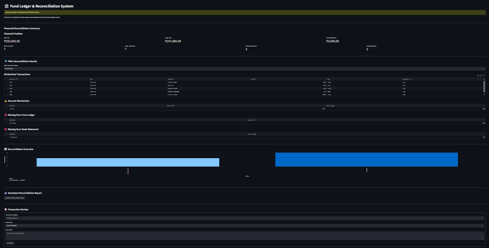

# Fund Ledger & Reconciliation System

A Python-based financial reconciliation prototype that compares bank statements with internal fund ledger records, identifies discrepancies, and maintains a permanent audit log.

## Features

- Read bank statements and fund ledger records from CSV files.
- Match financial transactions using date, description, amount, and transaction type.
- Detect amount mismatches.
- Identify transactions missing from either record.
- Display financial summary metrics.
- Visualize reconciliation results.
- Filter reconciliation results by category.
- Export reconciliation reports as CSV.
- Record transaction reviews.
- Store audit records permanently using SQLite.

## Technologies Used

- Python
- Pandas
- Streamlit
- SQLite
- Matplotlib
- CSV

## Project Structure

```text
fund-ledger-reconciliation/
├── app.py
├── database.py
├── bank_statement.csv
├── fund_ledger.csv
├── fund_operations.db
├── requirements.txt
└── README.md
```

## Installation and Setup

1. Clone or download this repository.
2. Install the required packages:

   `pip install -r requirements.txt`

3. Run the application:

   `python -m streamlit run app.py`

4. Open the local URL displayed in your terminal.

## Sample Reconciliation Results

The included fictional dataset demonstrates:

- 5 matched transactions.
- 1 amount mismatch.
- 1 transaction missing from the fund ledger.
- 1 transaction missing from the bank statement.

## Learning Objectives

This project demonstrates practical skills in financial data processing, reconciliation logic, Python programming, database operations, and interactive dashboard development.

## Future Improvements

- Add double-entry bookkeeping validation.
- Support Excel uploads.
- Add user authentication and access controls.
- Improve transaction matching with configurable tolerances.
- Introduce machine learning for financial anomaly detection.
- Add permanent review history and reporting enhancements.

## Disclaimer

This is an educational prototype using fictional financial data. It is not production-ready accounting software and does not provide financial or compliance advice.

## Dashboard Preview


